<div align="center">

# 🚀 SmartBids — Inteligencia para Ofertar

**Plataforma SaaS de Inteligencia Comercial y Analítica Predictiva para el Mercado de Compras Públicas (Mercado Público / ChileCompra)**  
*Transformando millones de datos abiertos en oportunidades estratégicas de negocio para MiPyMEs y proveedores del Estado.*

[](https://www.python.org/)
[](https://www.djangoproject.com/)
[](https://www.postgresql.org/)
[](https://firebase.google.com/)
[](https://scikit-learn.org/)
[](https://www.bcn.cl/)

[📖 Consultar Guía Rápida de Instalación y Comandos Git (readme.txt)](./readme.txt)

</div>

---

## 📌 1. Visión General y Propuesta de Valor

En el ecosistema de compras públicas de Chile se transan miles de millones de dólares anualmente. Sin embargo, las pequeñas y medianas empresas (MiPyMEs) pierden hasta un 80% de su tiempo en búsquedas manuales, revisión de extensas bases administrativas y seguimiento de plazos fatales.

**SmartBids** automatiza este proceso mediante:
1. **Perfilamiento Algorítmico:** Concordancia porcentual automática entre las capacidades comerciales de la empresa y los requisitos de cada licitación (catálogo de productos ONU, rubros y zonas geográficas).
2. **Estimación Predictiva (Machine Learning):** Modelos entrenados con el histórico de compras públicas para anticipar la factibilidad de adjudicación y precios referenciales.
3. **Resiliencia Operativa:** Integración híbrida con bases de datos relacionales PostgreSQL y un motor de extracción en vivo (*fallback*) hacia las fichas oficiales de Mercado Público para anexos y foros de preguntas.
4. **Cumplimiento Legal y Transparencia:** Adhesión estricta a la **Ley N° 21.719** de Protección de Datos Personales (derechos ARCOP), autenticación en dos pasos (2FA/OTP) y exportación portátil de registros.

---

## 🏗️ 2. Arquitectura del Sistema y Flujo de Datos

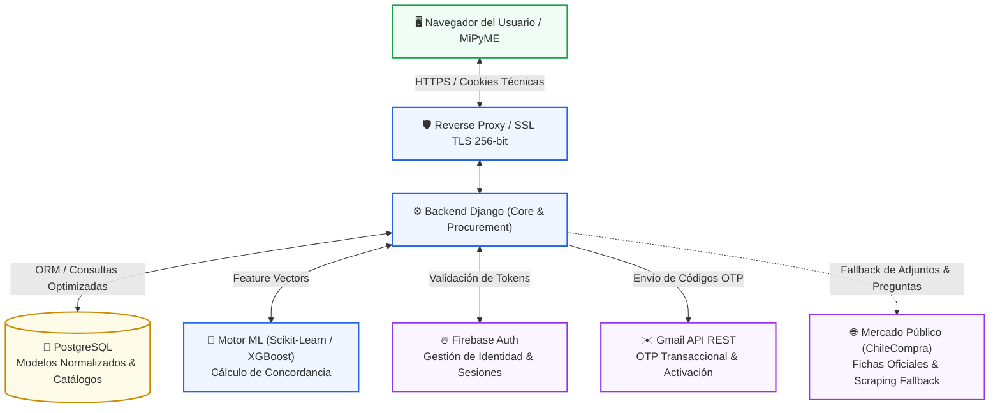

---

## 🎬 3. Recorrido Integral de Usuario (Onboarding End-to-End)

El siguiente flujo documenta el ciclo de vida real de un nuevo proveedor registrado en la plataforma (`alexsander.munoz@chileavanza.cl`), demostrando la integración entre frontend, backend, seguridad y notificaciones de correo institucional.

### 🌟 Portada y Transparencia en Privacidad
La plataforma recibe al usuario con su propuesta de valor, métricas de mercado analizadas y un aviso claro de consentimiento de cookies y almacenamiento técnico conforme a la Ley N° 21.719.

| Portada Principal (Hero Section) | Banner de Cookies y Privacidad (Ley N° 21.719) |
| :---: | :---: |
| 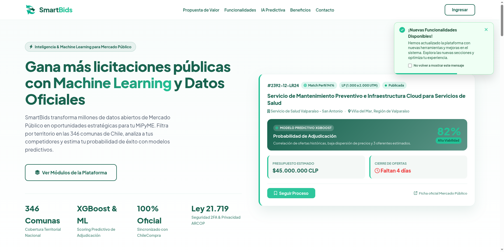 | 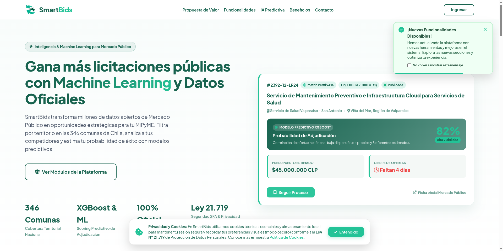 |
| *Métricas clave (+19,3 M USD analizados) y llamada a la acción.* | *Consentimiento informado previo a la navegación de datos.* |

---

### 📝 Registro y Validación de Credenciales
El formulario valida en tiempo real la integridad del correo electrónico, fortaleza de claves y el consentimiento explícito de los Términos del Servicio y Política de Privacidad.

| Propuesta de Valor MiPyME | Formulario de Registro Corporativo |
| :---: | :---: |
| 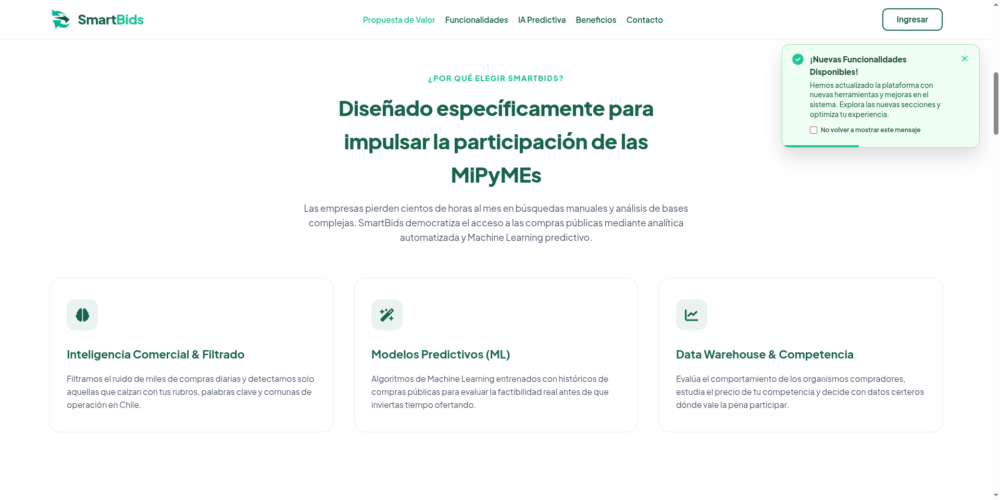 | 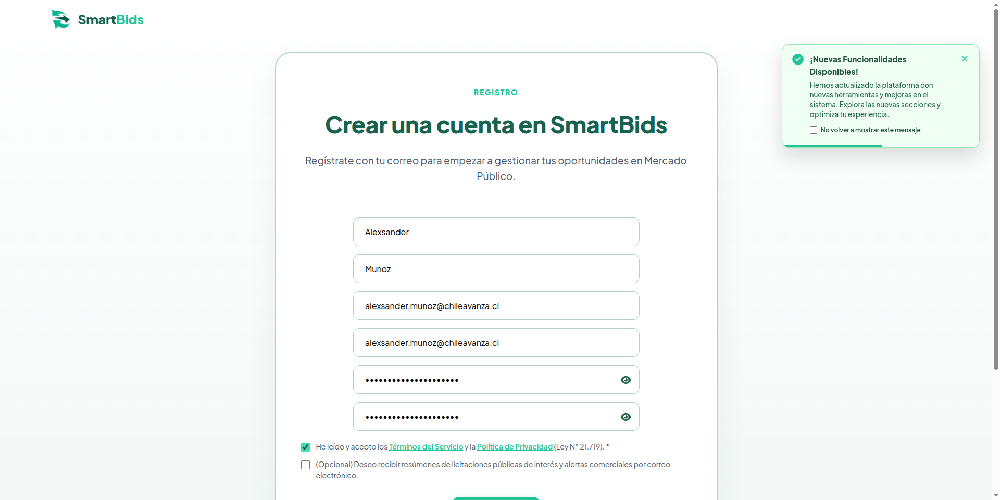 |
| *Detalle de beneficios tangibles y reducción de tiempos.* | *Inscripción con verificación de dominios y aceptación legal.* |

---

### ✉️ Verificación de Identidad por Correo Electrónico
Para garantizar la legitimidad corporativa y evitar cuentas falsas, SmartBids despacha un correo transaccional de bienvenida con enlace seguro de un solo uso (`oobCode`).

| Confirmación de Registro Enviado | Correo de Activación en Gmail Corporativo |
| :---: | :---: |
| 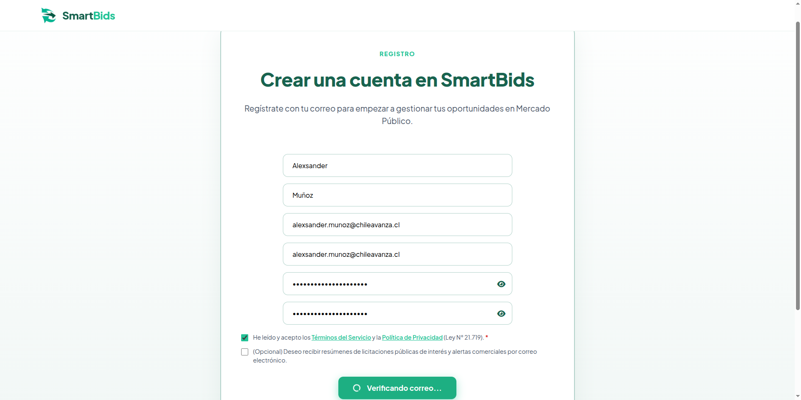 | 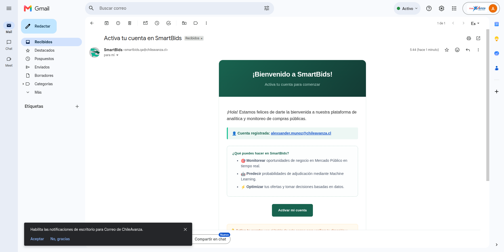 |
| *Notificación en pantalla orientando a revisar la bandeja de entrada.* | *Plantilla responsiva recibida en alexsander.munoz@chileavanza.cl.* |

| Pantalla de Confirmación de Enlace | Cuenta Activada Exitosamente |
| :---: | :---: |
| 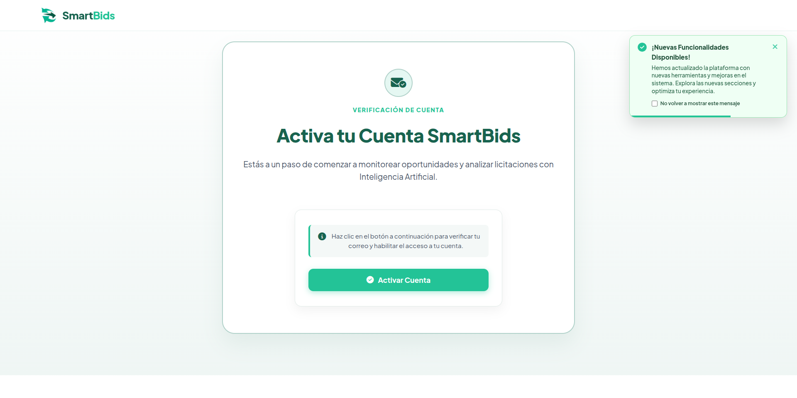 | 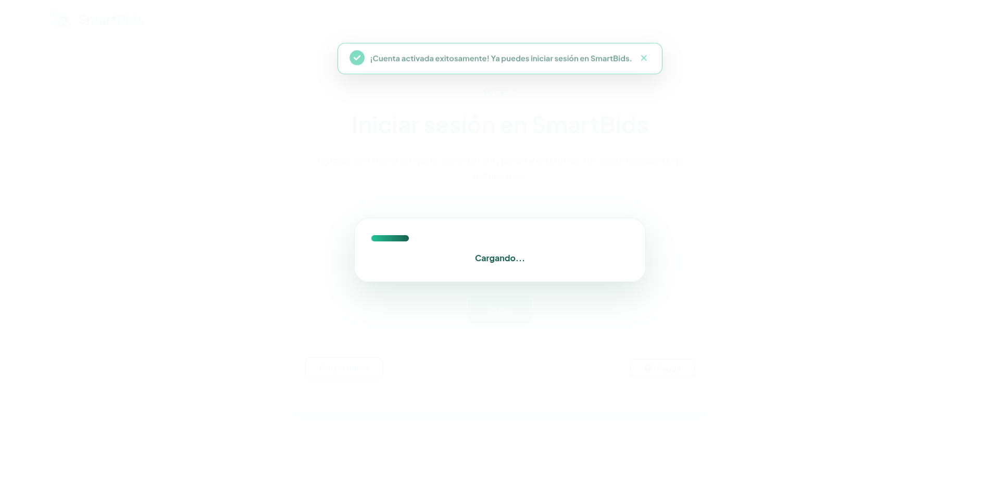 |
| *Validación criptográfica del token de activación.* | *Habilitación inmediata del usuario en la base de datos.* |

---

### 🔐 Autenticación y Doble Factor de Seguridad (2FA / OTP)
Cada inicio de sesión requiere la verificación de dos pasos mediante un código numérico dinámico de 6 dígitos con caducidad estricta de 10 minutos.

| Inicio de Sesión (Con Revelador de Clave) | Modal de Verificación 2FA / OTP |
| :---: | :---: |
| 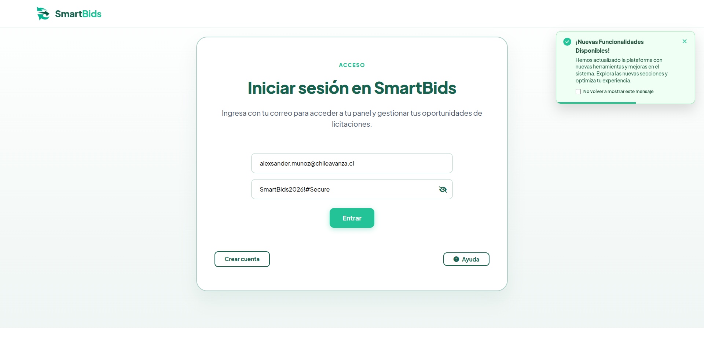 | 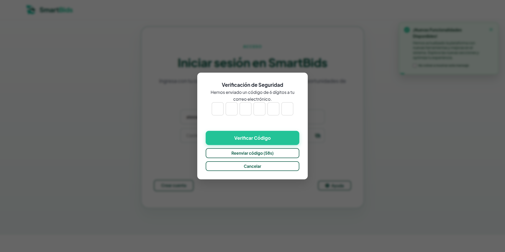 |
| *Acceso seguro con botón de inspección visual de contraseña.* | *Casilleros segmentados con salto automático de cursor.* |

| Correo Transaccional con Código OTP en Gmail | Validación e Ingreso Autorizado |
| :---: | :---: |
| 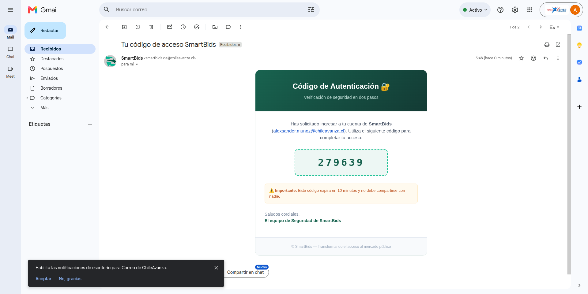 | 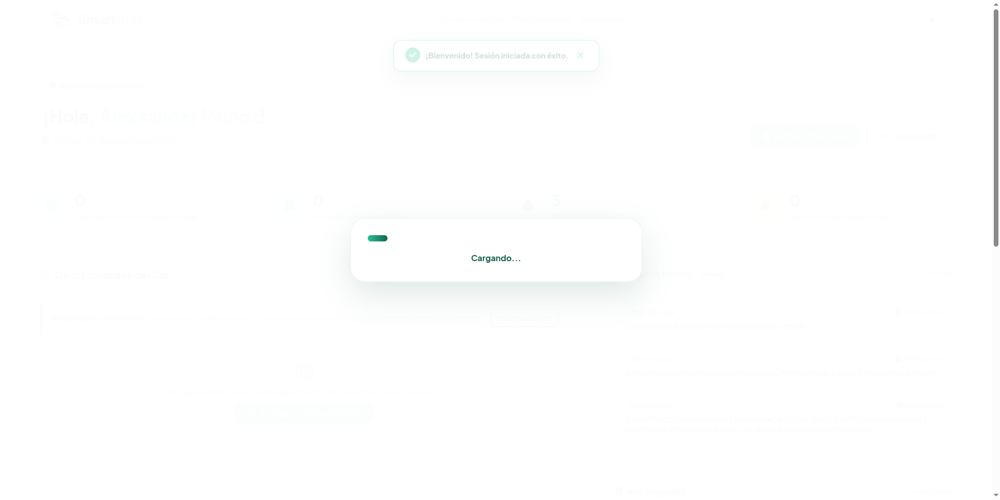 |
| *Código de seguridad recibido con aviso de caducidad.* | *Autocompletado y validación inmediata del token de sesión.* |

---

## 👤 4. Perfilamiento Inteligente y Calibración del Algoritmo

Para que los modelos de Machine Learning entreguen recomendaciones de alta precisión, la plataforma guía al usuario a completar su perfil comercial y tributario.

| Asistente de Calibración Activa | Datos Tributarios y de la Empresa |
| :---: | :---: |
| 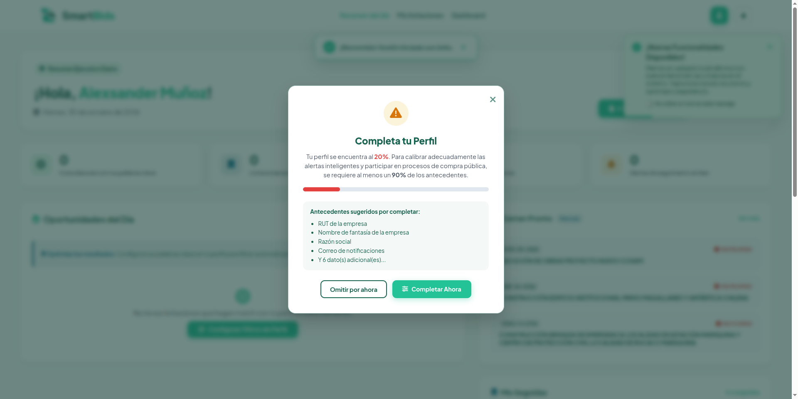 | 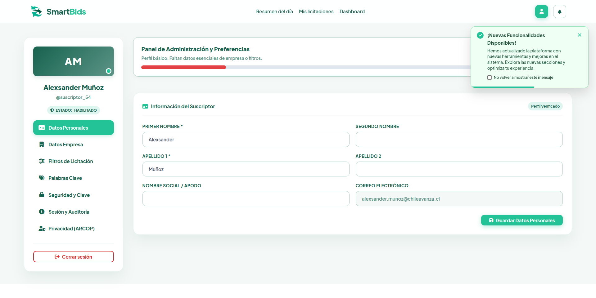 |
| *Indicador de avance hacia el 90% requerido para calibrar el algoritmo.* | *RUT, Razón Social, dirección comercial y canales de notificación.* |

| Filtros de Mercado y Palabras Clave | Catálogo de Oportunidades Personalizadas |
| :---: | :---: |
| 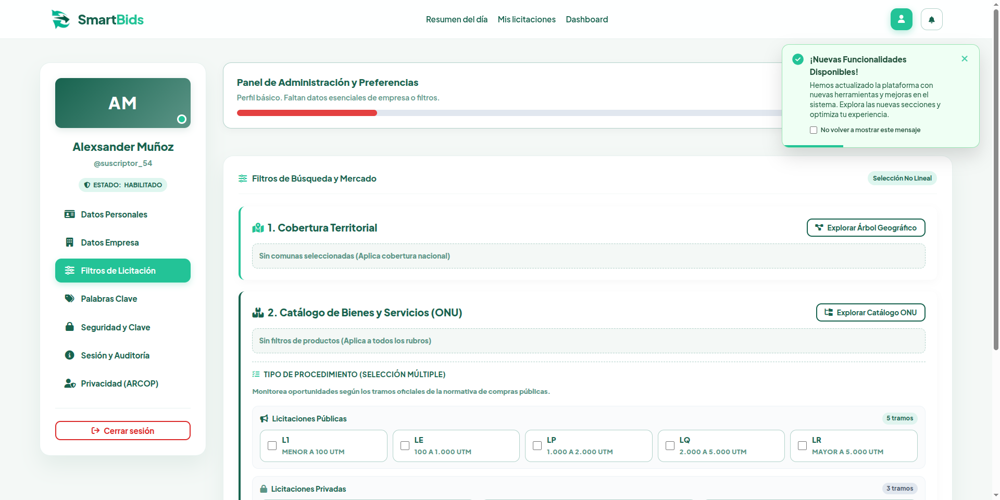 | 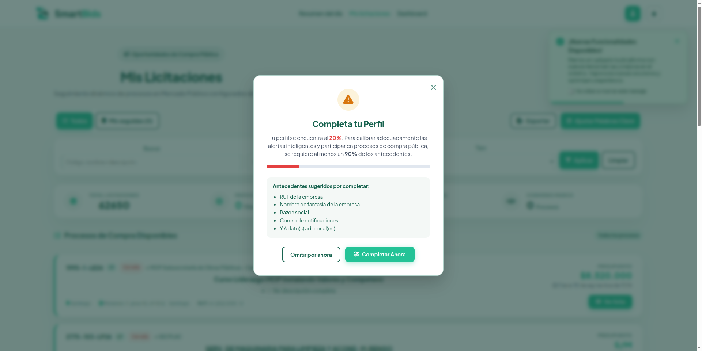 |
| *Configuración por rubro, productos ONU y regiones de interés.* | *Listado dinámico filtrado con cálculo de días restantes.* |

---

## 📊 5. Analítica de Mercado, Ficha Técnica y Exportación

| Exportación Multi-formato (Excel & CSV) | Ficha Detallada de Licitación con Cronograma |
| :---: | :---: |
| 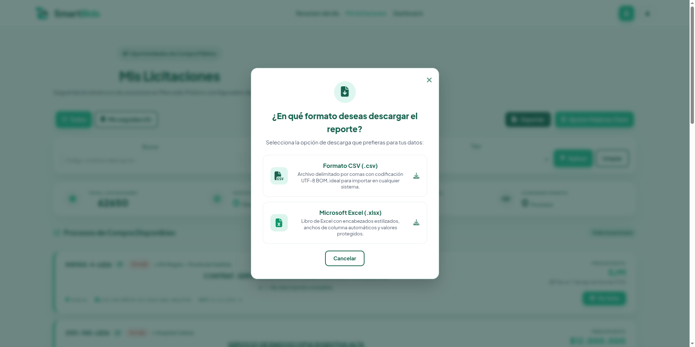 | 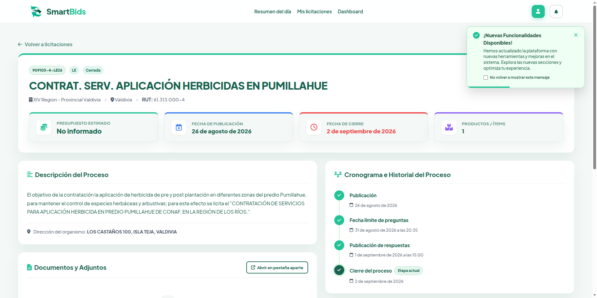 |
| *Descargas en `.xlsx` estilizado o `.csv` UTF-8 BOM sanitizado.* | *Hitos del proceso, presupuesto estimado y repositorio de bases.* |

| Dashboard Analítico de Transacciones | Experiencia Visual en Modo Oscuro (Dark Mode) |
| :---: | :---: |
| 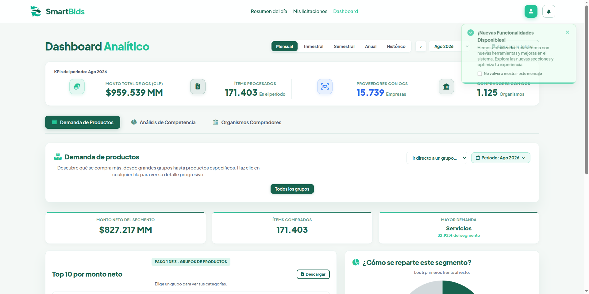 | 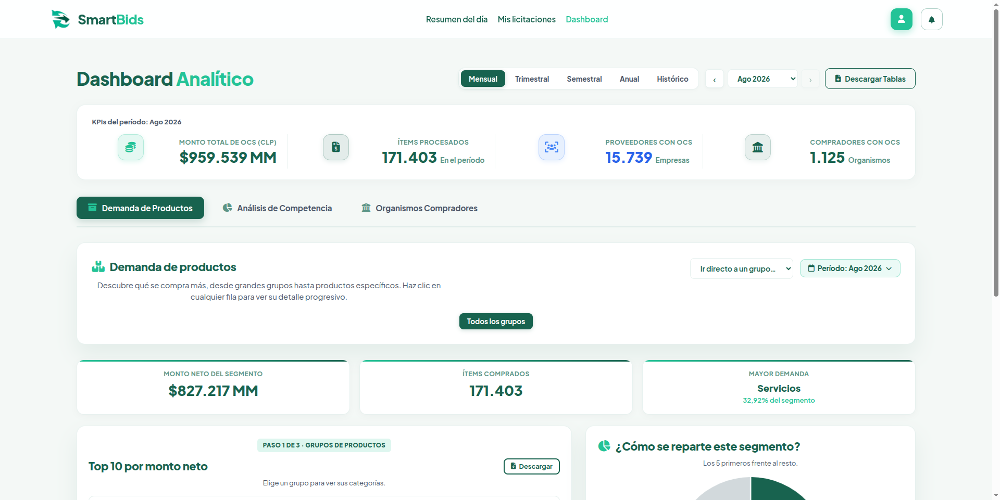 |
| *Métricas consolidadas, montos transados y rubros más demandados.* | *Tema oscuro de alto contraste persistido en almacenamiento local.* |

---

## 🛡️ 6. Cumplimiento Normativo y Derechos ARCOP (Ley N° 21.719)

SmartBids implementa desde su arquitectura el marco de protección de datos personales de Chile:

* **Acceso y Portabilidad:** El suscriptor puede exportar la totalidad de sus datos personales, empresa y preferencias en formato `.json` estandarizado con un solo clic desde su perfil.
* **Rectificación:** Modificación instantánea de datos de contacto y parámetros comerciales.
* **Cancelación y Supresión:** Módulo de solicitud legal de eliminación definitiva de cuenta y revocación de consentimientos.
* **Seguridad de la Información:** Cifrado en reposo, firmas HMAC en tokens de sesión y protección activa contra ataques CSRF, XSS e inyecciones SQL.

---

## 👥 Metodología Ágil y Equipo de Desarrollo

El proyecto se gestionó bajo el marco de trabajo **Scrum**, estructurado en iteraciones cortas (Sprints) orientadas a la entrega continua de valor incremental:

* ⏱️ **Planificación por Sprints:** Definición y priorización de backlog según los objetivos y alcance comprometido del producto.
* 📋 **Seguimiento y Control:** Registro y auditoría de avances, tareas técnicas y mitigación de bloqueos mediante bitácoras semanales.
* 🔄 **Mejora Continua:** Retrospectivas periódicas, evaluación de resultados y adaptación dinámica a nuevos requerimientos.

### 💼 Roles y Estructura del Equipo

| Integrante | Rol en el Proyecto | Responsabilidades Clave |
| :--- | :--- | :--- |
| **Andrés Santoro** | **Product Owner & CEO** | Visión del producto, ideación y definición de la propuesta de valor para el ecosistema de compras públicas y priorización del backlog de negocio. |
| **Matías González** | **Scrum Master** | Facilitación del marco Scrum, gestión de ceremonias y bitácoras de avance, asegurando el cumplimiento de hitos y la documentación integral. |
| **Flavia Oneto** | **Team Developer (Data & DB Engineer)** | Modelado y optimización de base de datos relacional (PostgreSQL), pipelines de transformación (ETL) y conciliación de modelos para el consumo eficiente en Django. |
| **Nicolás Muñoz** | **Team Developer (Frontend, Cloud & Security)** | Arquitectura y desarrollo de la interfaz de usuario (UI/UX), infraestructura cloud (hosting, dominio/URL personalizada y SSL) y seguridad de la plataforma (autenticación 2FA/OTP y control de sesiones). |

---

## 🛠️ Stack Tecnológico

| Capa | Tecnologías |
| :--- | :--- |
| **Backend & Framework** | Python 3.10+, Django 5.x, Gunicorn, WhiteNoise |
| **Base de Datos & Caché** | PostgreSQL (Relacional normalizada), Django Cache Framework |
| **Machine Learning** | Scikit-Learn, XGBoost, Pandas, NumPy |
| **Frontend & UI/UX** | HTML5 Semántico, CSS3 Modular (Variables & Dark Theme), JavaScript ES6+ Vanilla |
| **Identidad & Seguridad** | Firebase Authentication, Google Identity, HMAC, 2FA/OTP Transaccional |
| **Integraciones Externas** | Gmail API REST (vía credenciales de servicio), Mercado Público (ChileCompra) Scraping Engine |
| **Testing & Automatización** | Django TestCase, Playwright (Pruebas End-to-End con CDP) |

---

## ⚙️ Instalación y Puesta en Marcha Local

Para clonar el repositorio y levantar el entorno local de desarrollo con dependencias completas:

```bash
# 1. Clonar el repositorio
git clone https://github.com/deralexsander/SmartBids.git
cd SmartBids

# 2. Crear y activar entorno virtual
python3 -m venv venv
source venv/bin/activate

# 3. Instalar requerimientos
pip install -r requirements.txt

# 4. Iniciar servidor de desarrollo
python manage.py runserver 127.0.0.1:8000
```

Para ver la guía exhaustiva con instrucciones detalladas para **Ubuntu/Debian**, **macOS** (Apple Silicon M1/M2/M3 / Intel) y **Windows**, consulta el archivo:

👉 **[Ver Guía Paso a Paso de Instalación (readme.txt)](./readme.txt)**

---

<div align="center">
  <small>© 2026 SmartBids — Desarrollado por el equipo de ChileAvanza. Todos los derechos reservados.</small>
</div>
